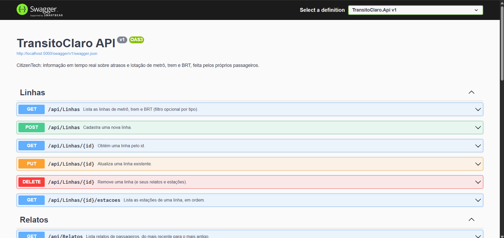
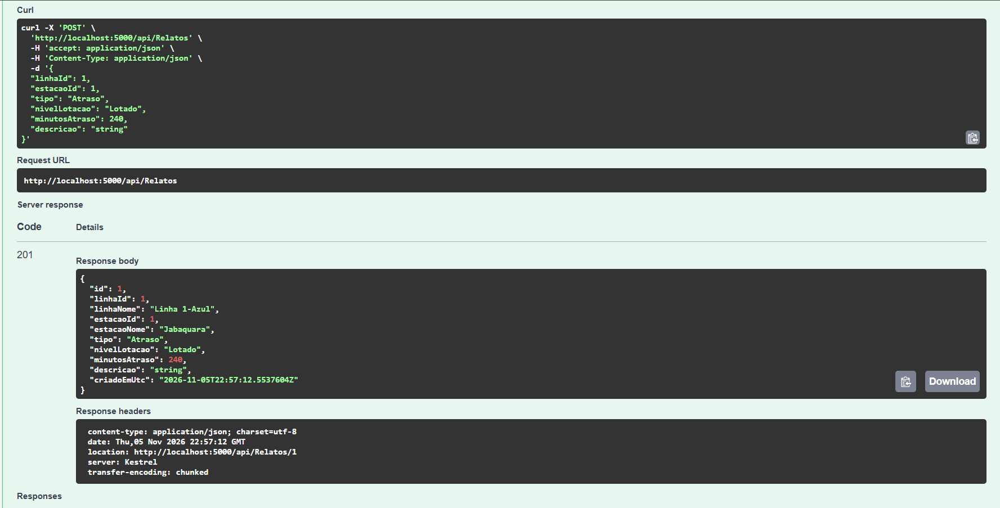
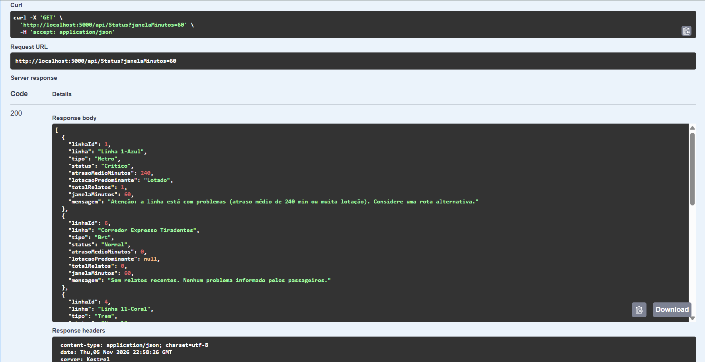

# TransitoClaro

**CitizenTech para quem depende de metrô, trem e BRT**

Global Solution 2026.2 · FIAP · Engenharia de Software · C# Software Development

O TransitoClaro é uma solução de tecnologia cívica desenvolvida para facilitar o acesso a informações sobre o transporte público. A proposta é permitir que passageiros consultem as condições das linhas antes ou durante seus deslocamentos, utilizando relatos colaborativos para identificar atrasos, problemas operacionais e situações de lotação.

## Integrantes

| Nome | RM |
|---|---|
| Pietro Vitor Pezzente | RM557283 |
| Eric Darakjian | RM557082 |
| Kauã Soares Guimarães | RM559044 |
| Enzo Mikael Sanches | RM558887 |

## Sobre o projeto

### Problema identificado

Passageiros que dependem do transporte público frequentemente enfrentam atrasos, superlotação e falhas operacionais sem acesso antecipado a informações sobre as condições das linhas. A falta de informação dificulta o planejamento dos deslocamentos e a escolha de rotas alternativas.

### Proposta

O TransitoClaro permite que passageiros registrem relatos anônimos sobre as condições do transporte público. A API processa essas informações e classifica as linhas em três níveis de situação:

- **Normal:** sem ocorrências relevantes identificadas.
- **Moderado:** presença de ocorrências que podem impactar o deslocamento.
- **Crítico:** situações que podem comprometer significativamente a viagem.

A classificação considera os relatos registrados dentro de uma janela de tempo configurável, apresentando também indicadores e mensagens explicativas para facilitar a interpretação dos resultados.

### Público beneficiado

Passageiros que utilizam metrô, trem ou BRT diariamente para deslocamentos relacionados ao trabalho, estudo e outras atividades.

### Tecnologias e integração

O projeto integra diferentes frentes de desenvolvimento da Global Solution:

| Área | Responsabilidade |
|---|---|
| C# Software Development | API REST, regras de negócio, persistência e classificação das linhas |
| Mobile | Aplicativo para consulta de status e envio de relatos |
| IoT | Simulação de sensores de lotação utilizando ESP32 |
| IA/ML | Análise histórica e previsão de possíveis atrasos |
| SOA, Operating Systems, Cybersecurity e Testing | Complementação da solução com serviços, infraestrutura, segurança e testes |

## Arquitetura

A aplicação segue uma arquitetura organizada em camadas, separando as responsabilidades de apresentação, aplicação, domínio e persistência.

```text
Controllers
    |
    v
Services (interfaces + DI)
    |
    v
AppDbContext (EF Core + SQLite)
    |
    v
Domain
(entidades, regras e estratégias)
```

### Estrutura do projeto

| Diretório | Responsabilidade |
|---|---|
| `Domain/` | Entidades, enums, exceções e regras de domínio |
| `Data/` | `AppDbContext`, configurações do EF Core e dados iniciais |
| `Services/` | Serviços de aplicação e interfaces |
| `Controllers/` | Endpoints da API REST |
| `Dtos/` | Contratos de entrada e saída, incluindo validações |
| `Infra/` | Abstrações de infraestrutura, relógio injetável e middleware de erros |

### Modelo de dados

A persistência utiliza Entity Framework Core com SQLite.

Principais entidades:

- **Linha:** representa uma linha ou corredor de transporte.
- **Estação:** representa uma estação ou terminal associado a uma linha.
- **RelatoCidadao:** registra uma ocorrência informada por um passageiro.

O banco possui relacionamentos entre linhas, estações e relatos, além de índices para otimizar consultas.

## Conceitos de C# aplicados

O desenvolvimento utiliza conceitos trabalhados na disciplina de C# Software Development.

| Conceito | Aplicação |
|---|---|
| POO | Herança e abstração em `EntidadeBase`, encapsulamento em `RelatoCidadao.Criar` e regras de domínio |
| Interfaces | `ILinhaService`, `IRelatoService`, `IStatusService`, `IClassificadorStatus` e `IRelogio` |
| Polimorfismo | Estratégia de classificação implementada por `IClassificadorStatus` |
| Injeção de dependência | Registro de serviços e interfaces no `Program.cs` |
| Entity Framework Core | Persistência, relacionamentos, índices, conversões e dados iniciais |
| LINQ | Agrupamentos, filtros, ordenação e cálculos estatísticos |
| API REST | Controllers, rotas HTTP e códigos de resposta apropriados |
| Async/Await | Operações assíncronas de acesso a dados com `CancellationToken` |
| Testes unitários | xUnit para validação do domínio, classificadores e serviços |

## Classificação das linhas

A classificação é realizada pela estratégia `ClassificadorPorRelatos`, considerando ocorrências registradas dentro do período consultado.

| Status | Critérios |
|---|---|
| Crítico | Atraso médio ≥ 15 minutos, ou ≥ 50% dos relatos de lotação classificados como `Lotado`, ou ≥ 3 falhas operacionais |
| Moderado | Atraso médio ≥ 5 minutos, ou ≥ 50% dos relatos classificados como `Cheio` ou `Lotado`, ou ≥ 1 falha operacional |
| Normal | Nenhum dos critérios anteriores foi atingido |

Linhas sem relatos recentes são classificadas como normais.

## Como executar

### Pré-requisitos

- [.NET 10 SDK](https://dotnet.microsoft.com/download/dotnet/10.0)
- Git

### Clonar o repositório

```bash
git clone <URL_DO_REPOSITORIO>
cd TransitoClaro
```

### Executar a API

Na raiz do repositório:

```bash
dotnet restore
dotnet run --project src/transitoclaro.api
```

A API será iniciada no endereço apresentado pelo terminal. No ambiente local configurado, a URL é:

```text
http://localhost:5000
```

O Swagger pode ser acessado em:

```text
http://localhost:5000/swagger
```

O banco SQLite `transitoclaro.db` é inicializado automaticamente na primeira execução, com dados de exemplo contendo 6 linhas e 22 estações.

### Executar os testes

```bash
dotnet test
```

## Endpoints

### Linhas

| Método | Endpoint | Descrição |
|---|---|---|
| GET | `/api/linhas` | Lista linhas, com filtro opcional por tipo |
| GET | `/api/linhas/{id}` | Consulta uma linha |
| GET | `/api/linhas/{id}/estacoes` | Lista estações de uma linha |
| POST | `/api/linhas` | Cadastra uma linha |
| PUT | `/api/linhas/{id}` | Atualiza uma linha |
| DELETE | `/api/linhas/{id}` | Remove uma linha |

### Relatos

| Método | Endpoint | Descrição |
|---|---|---|
| POST | `/api/relatos` | Registra um relato anônimo |
| GET | `/api/relatos` | Lista relatos com filtros e paginação |
| GET | `/api/relatos/{id}` | Consulta um relato |
| DELETE | `/api/relatos/{id}` | Remove um relato |
| GET | `/api/relatos/estatisticas` | Retorna indicadores e estatísticas |

### Status

| Método | Endpoint | Descrição |
|---|---|---|
| GET | `/api/status` | Consulta o status de todas as linhas |
| GET | `/api/status/{linhaId}` | Consulta o status de uma linha específica |

Os endpoints de consulta de status permitem configurar a janela de análise por meio do parâmetro `janelaMinutos`.

## Exemplo de utilização

### Registro de relato

**Requisição**

```http
POST /api/relatos
Content-Type: application/json
```

```json
{
  "linhaId": 4,
  "estacaoId": 14,
  "tipo": "Atraso",
  "minutosAtraso": 18,
  "descricao": "Trem parado há 10 minutos"
}
```

### Consulta de status

**Requisição**

```http
GET /api/status/4?janelaMinutos=60
```

**Resposta ilustrativa**

```json
{
  "linhaId": 4,
  "linha": "Linha 11-Coral",
  "tipo": "Trem",
  "status": "Critico",
  "atrasoMedioMinutos": 18,
  "totalRelatos": 1,
  "janelaMinutos": 60,
  "mensagem": "Atenção: a linha está com problemas (atraso médio de 18 min ou muita lotação). Considere uma rota alternativa."
}
```

## Dados e privacidade

O sistema não exige identificação pessoal para o envio de relatos. As informações registradas são utilizadas para análise das condições das linhas e geração de indicadores.

O banco contém dados iniciais de exemplo, incluindo linhas e estações de São Paulo. Os relatos utilizados durante o desenvolvimento e as demonstrações podem ser simulados, não representando necessariamente ocorrências reais do transporte público.

## Integração com as demais disciplinas

A API funciona como componente central da solução TransitoClaro.

- **Mobile:** consulta `/api/status` e envia relatos por `POST /api/relatos`.
- **IoT:** sensores simulados no ESP32/Wokwi podem enviar informações de lotação à API.
- **IA/ML:** utiliza o histórico de relatos como base para análises e previsões.
- **SOA:** permite a integração entre os componentes da solução por meio de serviços e contratos definidos.
- **Cybersecurity:** contribui para a proteção dos endpoints e dos dados processados.
- **Testing:** valida o comportamento dos serviços, regras de negócio e endpoints.

## Indicadores de impacto

O TransitoClaro disponibiliza informações que podem ser utilizadas para avaliar as condições do transporte público.

Entre os indicadores previstos estão:

- Quantidade de relatos registrados por período.
- Linhas com maior incidência de atrasos.
- Distribuição de ocorrências por tipo.
- Média de atrasos registrados.
- Identificação de linhas com status crítico.

O objetivo é contribuir para decisões de deslocamento mais informadas e facilitar a identificação de problemas recorrentes.

A meta de impacto da solução é reduzir a incerteza do passageiro durante o planejamento de suas viagens.

## Evidências de funcionamento

### Swagger



### Registro de relato — POST /api/relatos



### Consulta de status — GET /api/status



## Repositório

GitHub: [TransitoClaro](https://github.com/PietroVP0777/Gs_2026_Cs)
